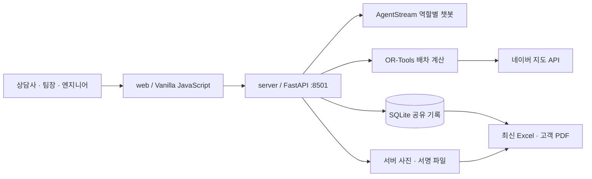

# 실행 구조와 데이터 흐름

- `web/index.html`, `web/app.js`: 업무 화면과 단계 전환. 공개 URL은 이전과 동일합니다.
- `web/dispatch/index.html`: 팀장 지도 화면. API 경로 `/api/dispatch/*`도 유지합니다.
- `server/app.py`: API·설정·명시적 정적 파일 공개 목록. `uvicorn server.app:app`으로 실행합니다.
- `server/routing.py`, `server/maps.py`: 보정 거리·평균속도로 배차 계산 후 도로 경로 조회. 실시간 교통 기반 최적화가 아닙니다.
- `server/records.py`: 버전 검사와 공유 기록. 데이터 파일은 Git 밖의 기존 경로를 유지합니다.
- `server/reports.py`, `server/report_demo.py`: 누적 이력 Excel, 고객 PDF. 내부 비고는 PDF 제외.
- `knowledge/`: 챗봇 구성 참고 문서. 로컬 실행 서버가 이 문서를 자동 학습하지 않습니다.
- `tests/web/`, `tests/server/`: 화면·업무·API·저장·보고서 검증. 테스트 자료는 합성 데이터입니다.
- `ops/`: runit으로 포트 8501 유지. 호스트 자체 중단까지 보장하지는 않습니다.

## 기존 경로와 대응

| 이전 | 현재 |
| --- | --- |
| frontend/의 HTML·JS·CSS·assets·data | web/ |
| frontend/dispatch/의 Python·배차 입력 | server/ |
| frontend/dispatch/index.html | web/dispatch/index.html |
| backend/의 Markdown 지식 자료 | knowledge/ |
| frontend/tests, frontend/dispatch/tests | tests/web, tests/server |
| frontend/docs, README, HANDOFF | docs/ |
| frontend/ops | ops/ |
| frontend/dispatch/.env.example | config/.env.example |
| frontend/dispatch/.env (비공개) | 기존 호스트 경로 유지 |

DB·사진·서명 경로와 공개 URL을 바꾸지 않고 소스 코드의 역할별 위치만 정리했습니다.
