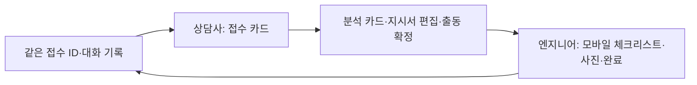

# 단일 챗봇 기반 접수·출동·현장조치 개발 순서

> 초기 계획 보관본입니다. 이후 사용자가 상담 원문 채팅, 통화 종료 후 잠금, 엔지니어 단계별 질문과 두 차례 고객 서명을 요청해 구현을 변경했습니다. 최신 작업 범위와 구현 상태는 `../HANDOFF.md` 및 `../README.md`를 우선하세요. 아래에는 현재 구현되지 않은 초기 계획도 포함됩니다.

2026 전남광주 기업 AX 혁신챌린지용 작업 계획 · 2026-11-07

## 한 문장 목표

**하나의 챗봇 대화**에서 상담사가 컴플레인을 접수·분석·확정하고, 엔지니어가 같은 접수 건을 모바일로 이어받아 현장 점검·완료 보고를 한다. AgentStream은 사례 검색과 지시서 초안을 담당하고, **출동 규칙은 서비스가 결정**한다.

## 범위와 우선순위

| 우선순위 | 구현할 것 | 완료 기준 |
|---|---|---|
| P0 | 단일 챗봇 대화와 역할별 카드 | 같은 접수 ID에서 상담사 → 엔지니어로 대화와 확정 지시서가 이어짐 |
| P0 | 출동 규칙을 코드로 고정 | 고객 방문 요청, 주행 불가, 유사 사례 없음은 각각 출동으로 표시되고 적용 규칙이 보임 |
| P0 | 합성 데이터 기반 모의 분석 | 키 발급 오류 중에도 접수부터 완료까지 전 과정을 시연 가능 |
| P0 | 근거 없는 정보 표시 | 고객 이력·유사 사례·출처가 없으면 `확인 필요`; 임의로 채우지 않음 |
| P0 | 공개 데모 배포와 시연 | 공개 URL에서 합성 데이터로 전체 흐름이 동작하고 GitHub 코드가 제출됨 |
| P0 | 작업 지시서 편집·확정 | 상담사가 수정한 내용과 확정 시각을 저장하고 모바일 화면에 같은 내용 표시 |
| P0 | 모바일 체크리스트·작업 상세·사진 | 체크 완료, 비포·애프터 사진, 상세 기록을 저장하고 다시 열어 확인 가능 |
| 키 발급 후 | AgentStream 서버 연동 | 키를 브라우저에 노출하지 않고 모의 분석 호출부만 교체 |
| P1 | 고객 서명과 세부 사용성 개선 | 핵심 흐름이 안정화된 뒤 추가 |
| P2 | 동선 최적화 | 제출 전 필수 범위에서 제외 |

## 한 챗봇 안의 세 단계

챗봇은 화면을 셋으로 분리하는 대신 **같은 대화창에 단계별 카드와 입력 컨트롤을 표시**한다. 상담사와 엔지니어는 역할이 다르지만 접수 ID와 확정된 작업 지시서를 공유한다. 개발 중에는 `상담사 보기 / 엔지니어 보기` 전환으로 시연할 수 있다.

상담사 PC와 엔지니어 휴대폰이 같은 접수 건을 열 수 있도록 대화·지시서·사진을 **서버에 저장**한다. 브라우저의 `localStorage`만 사용하면 기기 사이에 기록이 공유되지 않는다.

### 1. 상담사 접수 카드

- 고객과 장비를 선택하거나 합성 데모 목록에서 고른다. 내부 ID를 저장하고 화면에는 필요한 정보만 보여준다.
- 증상은 자유 입력으로 받는다.
- **고객 방문 요청 / 주행 불가 / 자가조치 희망**은 각각 별도의 예·아니오 필드로 받는다. `알 수 없음`을 허용한다면 별도 확인 대상으로 취급한다.
- 저장 후 접수 ID를 만들고 같은 대화에 분석 요청과 결과 카드를 이어서 표시한다.

### 2. 분석 결과·출동 확정 카드

- 고객 과거 접수 이력, 유사 사례, 각 사례의 원문 ID·출처·관련성을 보여준다.
- AI 작업 지시서 초안은 단계별 체크 항목, 예상 조치, 안전 주의, 확인 필요 항목으로 구성한다.
- 출동 여부와 **적용된 규칙**을 AI 응답과 분리해 표시한다.
- 상담사는 지시서를 수정한 뒤 확정한다. 수정 전 초안과 최종본, 수정자·확정 시각을 기록한다.
- 정보가 없거나 근거가 약한 필드는 `확인 필요`로 두고 상담사가 채울 수 있게 한다.

### 3. 엔지니어 모바일 카드

- 확정된 지시서를 읽고 체크리스트를 완료한다.
- 실제 작업 내용, 결과, 미해결 사항을 입력한다.
- 비포·애프터 사진을 촬영 또는 업로드하고 완료 보고를 저장한다.
- 고객 서명은 시간이 남을 때 추가하되, 원래 업무 흐름에는 포함된 항목임을 발표 범위에서 설명한다.

### 대화 상태와 기록

`접수 중 → 분석 중 → 상담사 검토 → 출동 확정/원격 안내 → 현장 작업 중 → 완료`를 접수 건에 저장한다. 챗 메시지에는 `role`, `caseId`, `type`, `createdAt`을 남기고, 카드 입력값은 메시지 문자열과 별도로 구조화해 저장한다. AI 응답을 다시 생성해도 상담사가 확정한 지시서는 덮어쓰지 않는다.

## 출동 규칙: 코드에서 결정

| 순서 | 조건 | 결과 |
|---|---|---|
| 1 | 고객이 방문을 요청 | 출동 |
| 2 | 주행 불가 | 출동 |
| 3 | 유사 사례 없음 | 출동·현장 데이터 확보 |
| 4 | 유사 사례가 있고 고객이 자가조치 희망 | 출동 없이 안전 안내 |
| 5 | 그 외 | 상담사 검토 후 원격 안내 또는 출동 확정 |

`유사 사례 없음`과 `자가조치 희망`이 겹치면 **출동**한다. 이 규칙은 사용자 확인을 반영했다. 단, 빈 지식베이스 때문에 검색 결과가 0건인 상황은 `유사 사례 없음`과 구분해 `분석 불가·확인 필요`로 표시하고, 상담사가 수동 판단하도록 한다. 시스템 오류를 근거 부재로 오인해 자동 결정을 내리지 않는다.

## 키 발급 오류 중에 만드는 연결 구조

1. 서비스 내부의 고정 응답 형식을 먼저 정한다. 예: `history[]`, `similarCases[{id, source, excerpt}]`, `workOrder{steps[], caution}`, `missingInfo[]`, `analysisStatus`.
2. `analyzeCase(caseId)` 호출 지점을 하나만 만든다. 지금은 `MockAnalyzer`가 **합성 사례 2~3건**을 반환하고 화면에 `데모 데이터`라고 표시한다.
3. 키가 발급되면 `AgentStreamAnalyzer`를 추가한다. 서버에서만 키를 읽고, 실제 API URL·인증 헤더·에이전트/지식베이스 ID·응답 형식을 확인해 같은 내부 형식으로 변환한다. 문제출제서에는 기능 범위만 있고 API 명세는 없다.
4. 빈 결과, 호출 오류, 시간 초과를 구분한다. 검색 실패를 `유사 사례 없음`으로 잘못 해석하지 않고 `확인 필요`로 처리한다.
5. 친구가 가공한 승인 데이터와 새 키를 받으면 키뿐 아니라 **에이전트/지식베이스 ID, 검색 품질, 응답 형식**도 함께 확인한다. 키 교체만으로 동일한 결과가 보장되지는 않는다.

### 친구와 지금 합의할 최소 계약

| 항목 | 필요한 값 |
|---|---|
| 사례 식별자 | `caseId`, 원문 또는 가공 문서 ID |
| 검색 근거 | 증상 요약, 해결 내용, 출처, 가능하면 관련 문장 |
| 결과 구분 | 검색 성공 0건 / 검색 실패 / 아직 데이터 없음 |
| 개인정보 | 고객명·연락처·주소·차량번호·서명·얼굴 등 제거 또는 가명화 |
| 연결 설정 | API 키, API URL, 에이전트/지식베이스 ID, 테스트 호출 예시 |

## 키 없이 오늘 바로 할 개발 순서

1. **공개 배포 뼈대를 일찍 만든다**: 저장소와 배포 URL을 연결해 빈 챗봇이라도 접근 가능하게 한다. 이후 기능별로 갱신한다.
2. **대화 상태와 공통 데이터 계약을 정한다**: 접수 ID, 역할, 메시지 종류, 분석 결과, 지시서 초안·확정본, 현장 보고를 정의한다.
3. **단일 챗봇 틀과 상담사 접수 카드**: 세 출동 관련 항목을 독립 필드로 받으며, 새로고침 뒤에도 같은 대화를 열 수 있게 한다.
4. **출동 규칙 함수와 모의 분석**: 합성 사례로 고객 이력·근거·지시서 초안을 만들고 충돌 조합을 테스트한다. 모의 결과임을 표시한다.
5. **상담사 확정 카드**: 출동 사유와 적용 규칙을 보여주고 지시서를 수정·확정해 저장한다.
6. **엔지니어 모바일 카드**: 같은 접수 건의 확정 지시서에 체크하고, 작업 상세·비포·애프터 사진·완료 보고를 저장한다.
7. **키 발급 후 연결**: `MockAnalyzer` 호출부를 `AgentStreamAnalyzer`로 교체하고 오류·빈 응답을 확인한다. 친구의 실제 데이터 전환은 그다음이다.
8. **시연·발표 마감**: 공개 URL, GitHub, PPT/PDF를 확인하고 약 7분 시연 경로를 2회 이상 반복한다.

## 마감 전 검증할 장면

- 고객 요청과 자가조치 희망이 함께 있어도 출동한다.
- 주행 불가와 자가조치 희망이 함께 있어도 출동한다.
- 유사 사례가 없고 자가조치 희망이어도 출동한다.
- AgentStream에 데이터가 없거나 호출이 실패하면 `확인 필요`가 보이고 허위 출처가 생성되지 않는다.
- 상담사가 수정·확정한 지시서가 엔지니어 모바일 화면에 그대로 표시된다.
- 상담사와 엔지니어가 **같은 접수 ID의 대화**를 이어서 사용하고 상태가 역행하지 않는다.
- 사진 업로드 후 완료 보고가 다시 조회되고, 공개 데모에는 합성 데이터만 보인다.

## 대회 조건과 시간 관리

- **마감: 11월 8일(일) 11:50.** 공개 접속 가능한 배포 URL, GitHub 저장소, 발표자료가 필요하다. 발표는 7분 시연·발표 + 3분 질의응답이다.
- 소부장·바이오·에너지 중 **한 분야를 명시**해야 한다. 차량/장비 서비스 문제를 어느 분야의 현안으로 설명할지 재직자와 확인한다.
- AIStream·AgentStream·DevStream 중 최소 하나를 실제로 사용해야 한다. **모의 분석만으로 제출 조건이 충족되지는 않는다.** 키 발급 오류를 주최 측에 기록해 알리고, 복구 후 실제 도구 연결 성공 장면과 사용 역할을 발표에 담는다.
- 공개 URL에는 합성 데이터만 게시한다. 실데이터는 승인·비식별 처리하고 공개 화면 접근을 제한한다.
- 대회 종료 후 제공 자원과 URL이 회수되므로 제출 전 코드·데이터·발표물을 별도로 백업한다.
- 동선 최적화, 복잡한 권한 관리, 정교한 자동 배차는 이번 핵심 시연 경로에서 제외한다.

## 자료 근거

- `AX혁신챌린지_참가자안내자료집_슬랙.pdf`: 제출 시각, 결과물, 발표 일정.
- `AX혁신챌린지_해커톤_문제출제서_참가팀배포용.pdf`: 도구·트랙·데이터 범위·공개 배포·평가 기준.
